# 🏝️ Morphing Island pour Quickshell

Un **îlot dynamique flottant** pour [Hyprland](https://hyprland.org), écrit en QML
avec [Quickshell](https://quickshell.org). Une pilule unique en haut de l'écran
qui **se transforme** (morphing par ressorts physiques *critically damped*, sans
rebond) en OSD, notification, lanceur, calculatrice, calendrier, centre de
contrôle, menu d'alimentation ou invite d'authentification. Le même code fournit
aussi l'**écran de connexion** (via greetd) et l'**écran de verrouillage**.

Toutes les icônes sont **vectorielles** (QtQuick.Shapes, zéro police d'icônes) :
nettes à n'importe quelle taille et recolorées par la couleur d'accentuation.

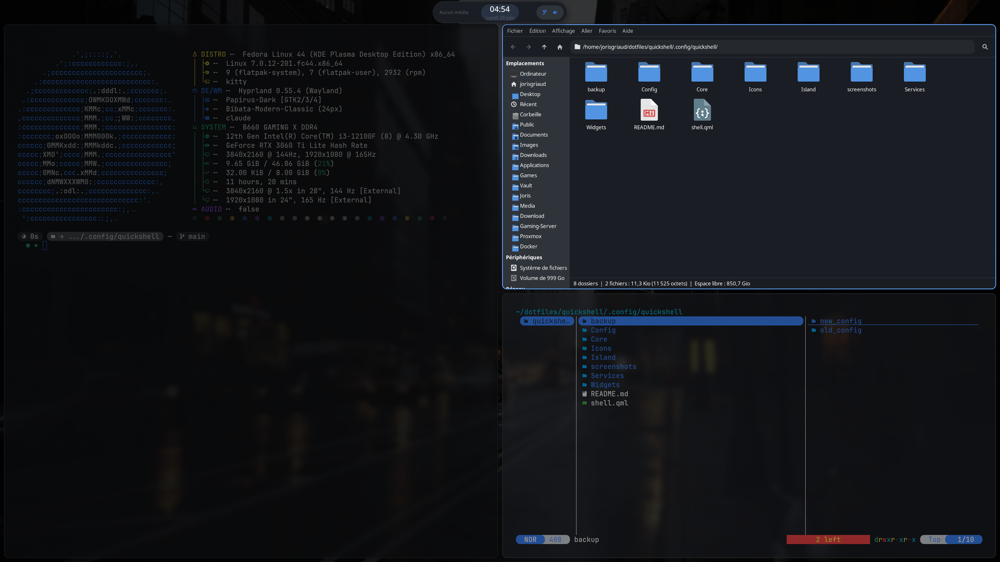

---

## ✨ Aperçu

**Au repos**, l'îlot affiche l'heure. **Au survol**, il s'étend : médias,
horloge centrée et pilule de statuts (réseau, ventilateur, volume, batterie,
luminosité).

| Repos | Survol (vue étendue) |
|---|---|
|  |  |

**OSD** volume / luminosité (rond déplaçable à la souris) et **notifications**
(normale + critique en rouge, survol = pause du chrono pour lire) :

| OSD volume | Notification | Notification critique |
|---|---|---|
| 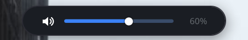 | 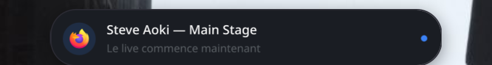 | 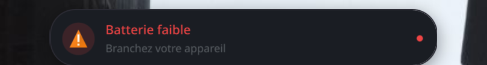 |

**Lanceur** (raccourci clavier, focus verrouillé, navigation 100 % clavier) :
applications, **calculatrice** (préfixe `=`) et **recherche de fichiers**
(préfixe `/`) :

| Applications | Calculatrice | Fichiers |
|---|---|---|
| 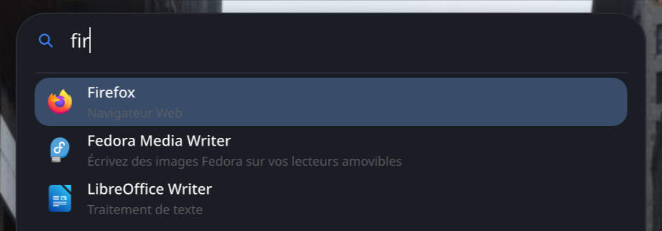 | 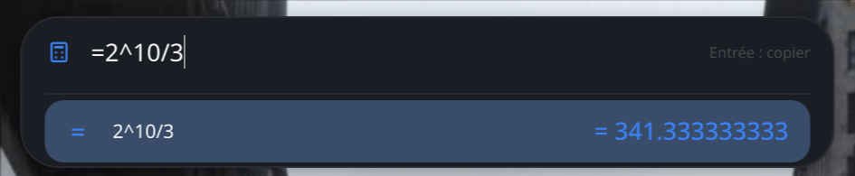 | 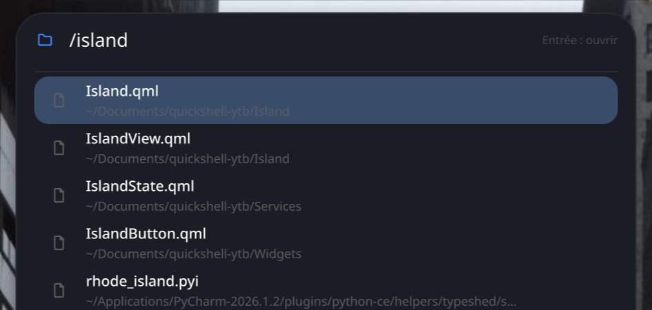 |

**Centre de contrôle** : tuiles (rond = bascule, fond = page de détail),
sliders volume/luminosité, carte média, historique des notifications
(clic = ouvrir, molette = retirer) :

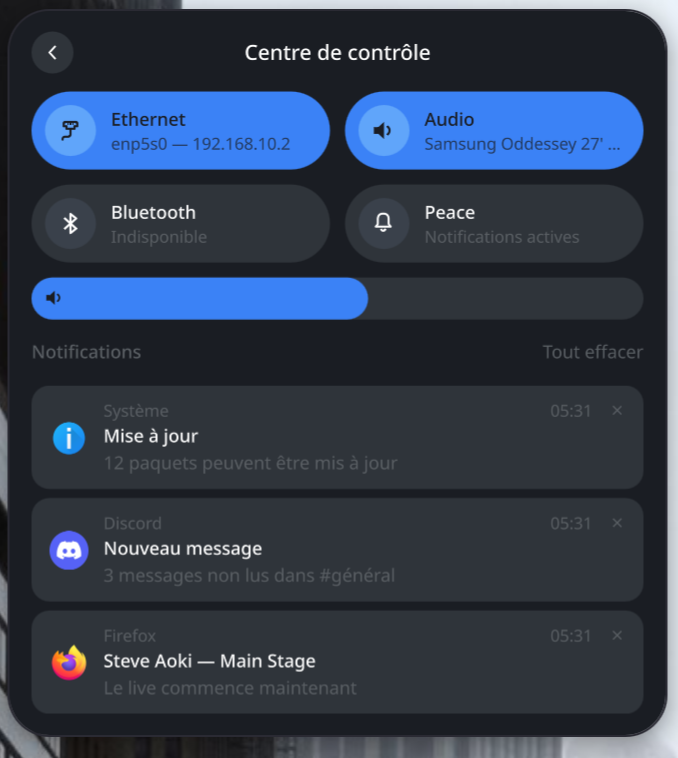

| Audio (sorties/entrées + renommage ✎) | Réseau | Bluetooth |
|---|---|---|
| 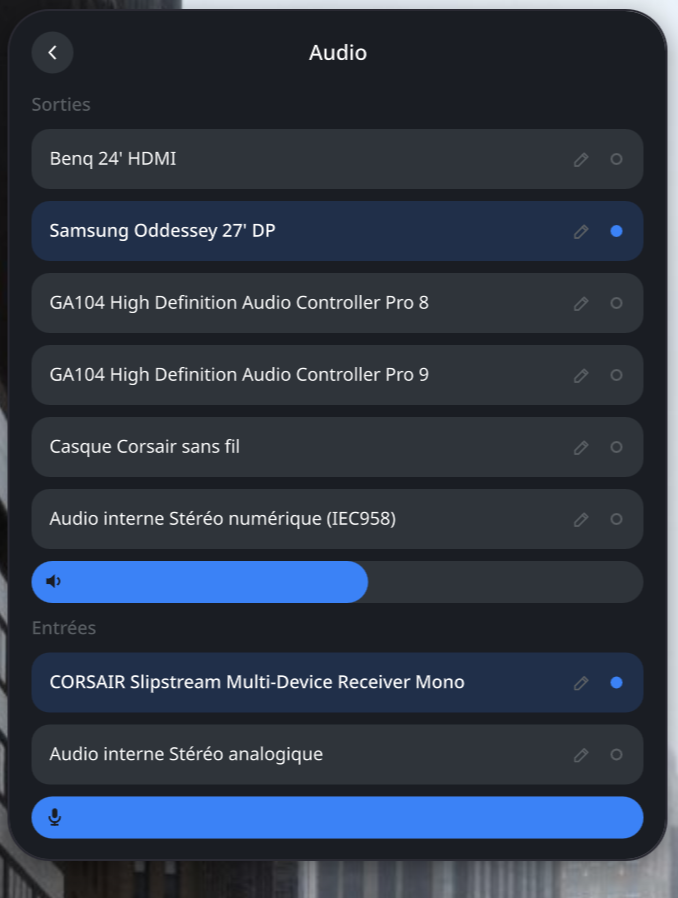 | 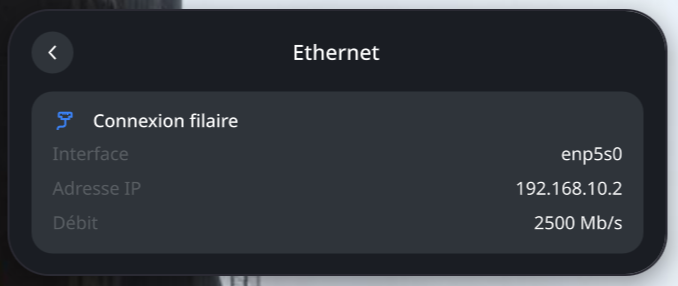 | 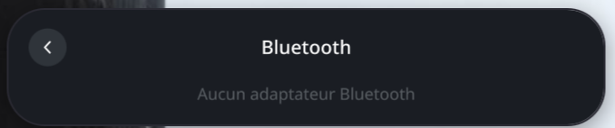 |

**Calendrier** (clic sur l'horloge) et **menu d'alimentation** (icônes seules,
navigation ←/→ ou Tab) :

| Calendrier | Menu power |
|---|---|
| 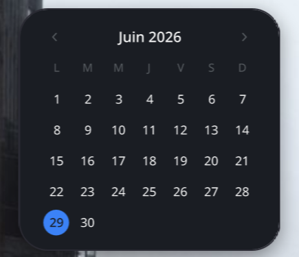 | 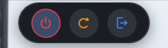 |

---

## 🧩 Fonctionnalités

- **Multi-écrans** : un îlot par écran ; OSD, notifications et panneaux ne
  sortent que sur l'écran focalisé.
- **Moteur d'animation** : ressort critiquement amorti (solution analytique
  exacte) : rapide, s'arrête net, **aucun overshoot**.
- **Icônes 100 % vectorielles** (Wi-Fi en jauge de signal, batterie style iOS
  avec éclair de charge, haut-parleur à ondes, soleil à rayons variables…).
- **Centre de contrôle** : Wi-Fi, Ethernet (interface + IP privée), Audio
  (choix des sorties/entrées **renommables**), Bluetooth, mode Ne pas déranger.
- **Lanceur** : recherche d'applications, **calculatrice** temps réel (`=`),
  **recherche de fichiers** (`/`, via `fd`).
- **Notifications** : file d'attente, pause au survol, critiques en rouge,
  mode « Peace », historique avec actions (ouvrir / retirer).
- **Polkit** : les demandes d'élévation s'affichent dans l'îlot.
- **Connexion et verrouillage** : greeter greetd et écran de verrouillage au
  même visuel (voir plus bas).
- **Plein écran** : la barre passive se masque pour ne pas surgir sur une vidéo.
- **Tout est centré** verticalement dans la bande, marges symétriques réglables.

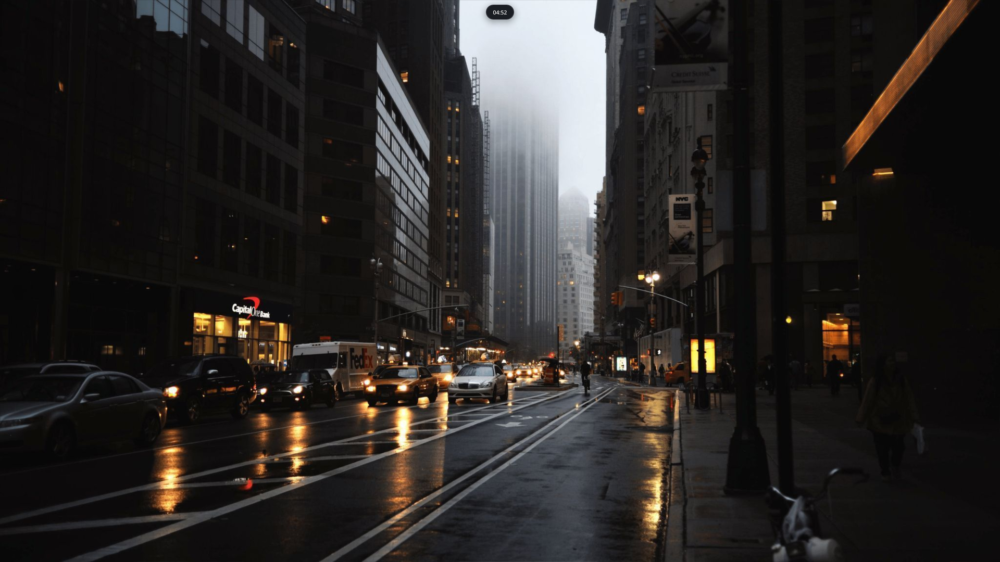

---

## 🔐 Connexion & verrouillage

Le dossier `Login/` contient un écran commun (`LoginSurface.qml`) utilisé de
deux façons :

- **Greeter** (`greeter.qml`) : lancé par **greetd** à la place de SDDM, dans
  un Hyprland minimal (`Login/greetd/hyprland-greeter.lua`). Grande horloge,
  avatar, champ du mot de passe, choix de la session (clic ou Tab), bouton
  éteindre. Plusieurs comptes → pastilles cliquables (ou ←/→).
- **Écran de verrouillage** (`Login/LockScreen.qml`, chargé par `shell.qml`) :
  même visuel, protocole `ext-session-lock`, mot de passe vérifié par PAM
  (`Login/pam/password`).

Sur plusieurs écrans, le formulaire suit la souris ; les autres écrans gardent
le fond et l'horloge. La position du curseur est lue avec `hyprctl cursorpos`
(`Login/CursorScreen.qml`) : le greeter prend le clavier en exclusivité, et
Hyprland garde alors aussi la souris sur sa fenêtre, donc le survol ne suffit pas. Le fond vient de `hyprpaper.conf`, l'avatar de `~/.face`
(ou de l'icône AccountsService).

**Essayer sans risque :**

```bash
qs -p ~/.config/quickshell/greeter.qml   # aperçu du greeter (Échap pour quitter)
qs ipc call lock preview                 # aperçu du verrouillage, sans verrouiller
qs ipc call lock closePreview            # ferme l'aperçu
```

**Installer le greeter** (le script copie la config dans `/etc/greetd/quickshell`,
car l'utilisateur `greetd` n'a pas accès à `$HOME`) :

```bash
sudo Login/greetd/install.sh            # installe greetd + copie (à relancer après chaque modif)
sudo Login/greetd/install.sh --enable   # active greetd (et désactive SDDM s'il est installé)
sudo Login/greetd/install.sh --revert   # retour à SDDM (réinstallé si besoin)
```

Les écrans et la disposition clavier du greeter sont fixés dans
`Login/greetd/hyprland-greeter.lua` : adapte-les à ta machine. Logs du greeter :
`/tmp/quickshell-greeter.log` et `journalctl -b -u greetd`.

---

## 📦 Installation

> Cette config fait partie de mes [dotfiles](https://github.com/jorisgriaud/dotfiles)
> et se déploie avec **GNU Stow**.

### Dépendances

| Paquet | Rôle |
|---|---|
| **quickshell** (≥ 0.3) | le shell QML lui-même |
| **hyprland** | compositeur Wayland (raccourcis globaux, focus écran) |
| **brightnessctl** | luminosité (PC portables) |
| **fd** | recherche de fichiers du lanceur (`/`) |
| **hyprsunset** | mode nuit *(optionnel, tuile désactivée par défaut)* |
| **greetd** + **rsync** | écran de connexion *(optionnel)* |
| polices **Inter** + **JetBrains Mono** | typographie |

Services utilisés automatiquement via Quickshell : **NetworkManager** (réseau),
**PipeWire** (audio), **UPower** (batterie), **BlueZ** (Bluetooth), **polkit**.

> ⚠️ Un seul service par session : si un **autre démon de notifications**
> (swaync, dunst, mako…) ou un **agent Polkit graphique** tourne déjà,
> désactive-le, sinon l'îlot ne pourra pas prendre la main.

### Déploiement (Stow)

```bash
git clone git@github.com:jorisgriaud/dotfiles.git ~/dotfiles
cd ~/dotfiles
stow quickshell          # crée les liens dans ~/.config/quickshell
quickshell -d            # lance le daemon (ou via exec-once Hyprland)
```

Autostart Hyprland (config Lua) :

```lua
hl.on("hyprland.start", function ()
    hl.exec_cmd("quickshell -d")
    hl.exec_cmd("hyprsunset")   -- si tu actives la tuile « Mode nuit »
end)
```

---

## ⌨️ Raccourcis & IPC

### Binds Hyprland (config Lua)

```lua
local mainMod = "SUPER"

-- Panneaux de l'îlot
hl.bind(mainMod .. " + A",         hl.dsp.exec_cmd("qs ipc call island toggleLauncher"))
hl.bind(mainMod .. " + N",         hl.dsp.exec_cmd("qs ipc call island toggleControlCenter"))
hl.bind(mainMod .. " + Delete",    hl.dsp.exec_cmd("qs ipc call island togglePower"))
hl.bind(mainMod .. " + R",         hl.dsp.exec_cmd("qs ipc call island toggleRefresh"))
hl.bind(mainMod .. " + L",         hl.dsp.exec_cmd("qs ipc call lock lock"))
-- filet de secours si l'îlot est figé
hl.bind(mainMod .. " + SHIFT + R", hl.dsp.exec_cmd("qs kill; qs -d"))

-- Volume : wpctl suffit, PipeWire déclenche l'OSD tout seul
hl.bind("XF86AudioRaiseVolume", hl.dsp.exec_cmd("wpctl set-volume -l 1 @DEFAULT_AUDIO_SINK@ 5%+"), { locked = true, repeating = true })
hl.bind("XF86AudioLowerVolume", hl.dsp.exec_cmd("wpctl set-volume @DEFAULT_AUDIO_SINK@ 5%-"),      { locked = true, repeating = true })
hl.bind("XF86AudioMute",        hl.dsp.exec_cmd("wpctl set-mute @DEFAULT_AUDIO_SINK@ toggle"),     { locked = true })

-- Luminosité : via l'IPC de l'îlot pour un OSD instantané
hl.bind("XF86MonBrightnessUp",   hl.dsp.exec_cmd("qs ipc call island brightnessUp"),   { locked = true, repeating = true })
hl.bind("XF86MonBrightnessDown", hl.dsp.exec_cmd("qs ipc call island brightnessDown"), { locked = true, repeating = true })
```

Raccourcis globaux natifs déclarés par le shell (appid `island`) : `launcher`,
`power`, `peace`, `refresh`, `lock`.

### Commandes IPC (`qs ipc call island <fn>`)

| Fonction | Effet |
|---|---|
| `toggleLauncher` | ouvre/ferme le lanceur |
| `toggleControlCenter` | ouvre/ferme le centre de contrôle |
| `toggleCalendar` | ouvre/ferme le calendrier |
| `togglePower` | ouvre/ferme le menu d'alimentation |
| `toggleRefresh` | ouvre/ferme le panneau de rafraîchissement (shell, réseau, son…) |
| `togglePeace` | bascule le mode Ne pas déranger |
| `ccPage <network\|audio\|bluetooth>` | ouvre directement une page du centre de contrôle |
| `volumeUp` / `volumeDown` / `muteToggle` | volume |
| `brightnessUp` / `brightnessDown` | luminosité |
| `reload` | rechargement dur (recrée les fenêtres) |

Verrouillage (`qs ipc call lock <fn>`) :

| Fonction | Effet |
|---|---|
| `lock` | verrouille la session |
| `preview` | affiche l'écran de verrouillage sans verrouiller (Échap ferme) |
| `closePreview` | ferme l'aperçu |
| `isLocked` | renvoie `true` si la session est verrouillée |

### Gestes souris

| Geste | Effet |
|---|---|
| Survol de la pilule | extension fluide |
| Clic dans le vide | épingle / désépingle l'îlot ouvert |
| Clic en dehors d'un panneau | le referme |
| Clic sur une notification | ouvre l'app/la page, molette = retire |

### Personnalisation

Tout est centralisé dans `Config/Theme.qml` (couleurs, typographie,
épaisseur de police, couleurs des tuiles et du menu power, vitesses des
ressorts) et `Config/Settings.qml` (tailles, marges, délais, préfixes du
lanceur). Les icônes lisent `Theme.accent`/`Theme.fg` : changer une couleur
recolore tout le shell.

---

## 🙏 Crédits

- Concept inspiré de cette vidéo : **[Morphing Island](https://youtu.be/wcm95W876OU)**.
- Construit avec **[Quickshell](https://quickshell.org)** sur
  **[Hyprland](https://hyprland.org)**.
